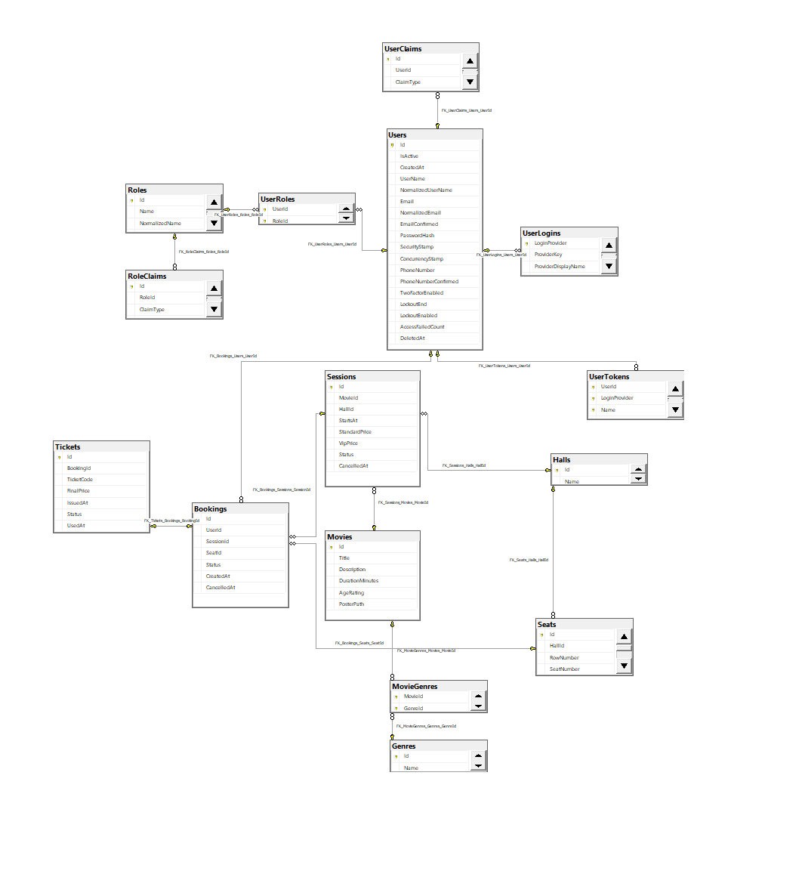
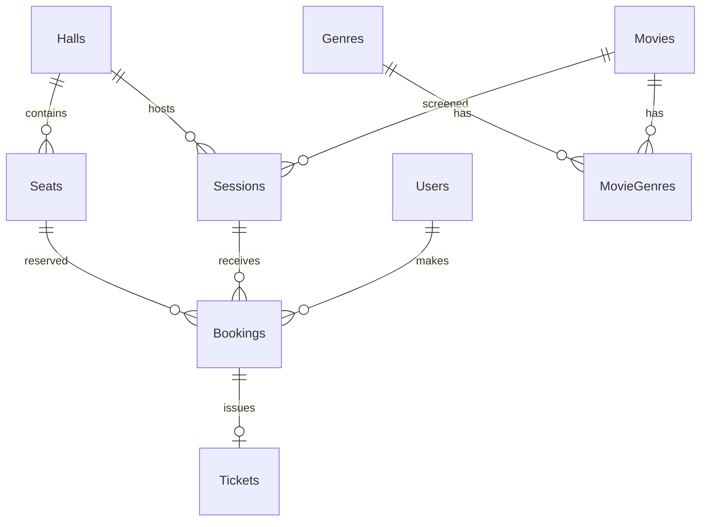

# CinemaGo API

Cinema ticket booking backend: browse movies and sessions, pick seats, book, get tickets, cancel.
ASP.NET Core Web API · EF Core (Code First) · SQL Server · JWT + ASP.NET Core Identity · Clean Architecture.

## Features
- JWT authentication, roles **SuperAdmin / Admin / Customer**, role-based authorization
- E-mail account activation (6-digit code), logout, password change and reset by e-mail, account deletion
- Movies with genres and **poster upload**; halls, seats (standard/VIP); sessions with overlap protection
- Seat map per session, **multi-seat booking in one transaction**, unique ticket codes, VIP/standard pricing
- Cancellation: bookings and sessions are soft-cancelled (`CancelledAt`), tickets become *Cancelled*
- Ticket **check-in** at the door, background job that marks past sessions *Finished*
- Admin reports (revenue per movie, session occupancy), filtering, sorting and paging
- Standardized success responses and RFC 7807 `ProblemDetails` errors, global exception middleware, Serilog logging
- Rate limiting and account lockout on authentication endpoints

## Architecture
```
CinemaGo.Domain          entities, enums, DTOs, repository/external interfaces, exceptions, constants
CinemaGo.Application     services, validators (FluentValidation), AutoMapper profile
CinemaGo.Infrastructure  DbContext, Identity, repositories, file storage, SMTP, migrations
CinemaGo.API             controllers, middleware, filters, Program.cs
CinemaGo.Tests           xUnit tests
```
Dependencies point inward: Infrastructure and Application depend only on Domain; API wires them with DI.

## Requirements
.NET SDK (same version as the projects), SQL Server (LocalDB, Express or full), Visual Studio 2022+.

## Run locally
1. Clone the repository and open `CinemaGo.sln`.
2. Set the connection string in `CinemaGo.API/appsettings.json` (`ConnectionStrings:DefaultConnection`).
3. Right-click **CinemaGo.API → Manage User Secrets** and add:
   ```json
   {
     "Jwt": { "Key": "<random string, at least 32 characters>" },
     "SeedData": { "SuperAdminEmail": "superadmin@cinemago.local", "SuperAdminPassword": "<strong password>" },
     "Email": { "Username": "<gmail address>", "Password": "<gmail app password>" }
   }
   ```
   `Email` is optional: without it e-mails are written to the log instead of being sent.
4. Press **F5**. On startup the app applies migrations and seeds roles, genres, halls, seats, movies, demo sessions and the SuperAdmin.
5. Swagger opens at `/swagger`. Log in with the SuperAdmin, click **Authorize** and paste the token.

Manual migration commands (Package Manager Console, default project `CinemaGo.Infrastructure`):
```
Add-Migration <Name> -Project CinemaGo.Infrastructure -StartupProject CinemaGo.API
Update-Database -Project CinemaGo.Infrastructure -StartupProject CinemaGo.API
```

## Responses
Every response (success and failure) uses the same envelope:
```json
{ "success": true,  "message": "Movie created successfully.", "data": { } }
{ "success": false, "message": "...", "data": null, "errors": { "field": ["..."] }, "code": "Booking.SeatTaken", "traceId": "..." }
```
`code` is stable and meant for clients; `errors` appears only for validation failures.
Texts live in `Domain/Constants`: `Errors.cs` (failures), `ValidationMessages.cs` (invalid input), `SuccessMessages.cs`.


## Business rules
- A seat has at most one active booking per session (filtered unique index + service check + concurrency handling).
- The seat must belong to the hall of the session; sessions in one hall cannot overlap (movie length + 15 min buffer).
- A customer cancels only their own booking, once, and only before the session starts.
- Ticket price: VIP seat → `VipPrice`, otherwise `StandardPrice`.
- Cancelled booking/session → tickets are *Cancelled*; check-in works once, from 60 min before the start until the end.

## Main endpoints
| Area | Endpoints |
|---|---|
| Auth | `POST /api/auth/register · confirm-email · resend-confirmation · login · logout · forgot-password · reset-password · change-password`, `GET /api/auth/me`, `DELETE /api/auth/account` |
| Users (Admin+) | `GET /api/users`, `POST /api/users/admins` (SuperAdmin), `PUT /{id}/role` (SuperAdmin), `PATCH /{id}/active`, `DELETE /{id}` |
| Catalog | `/api/genres`, `/api/movies` (+ `/{id}/poster`), `/api/halls` (+ `/{id}/seats`), `/api/seats` |
| Sessions | `GET /api/sessions`, `GET /{id}`, `GET /{id}/seats`, `POST`, `PUT /{id}`, `DELETE /{id}` |
| Bookings | `POST /api/bookings`, `GET /my`, `GET /{id}`, `DELETE /{id}` |
| Tickets | `GET /api/tickets/{id}`, `GET /by-code/{code}`, `POST /by-code/{code}/check-in` |
| Reports (Admin+) | `GET /api/reports/revenue-by-movie`, `/session-occupancy` |

## Database



Identity tables are renamed to `Users`, `Roles`, `UserRoles`, ... Roles are linked through `UserRoles` (justified extension of `Users.RoleId`).
Deleting a user anonymizes the row so booking history and revenue stay correct.

## Tests
`Test → Run All Tests` (xUnit + NSubstitute): booking rules, pricing, concurrency, session overlap, ticket check-in, authentication flows, deletion rules, validators.